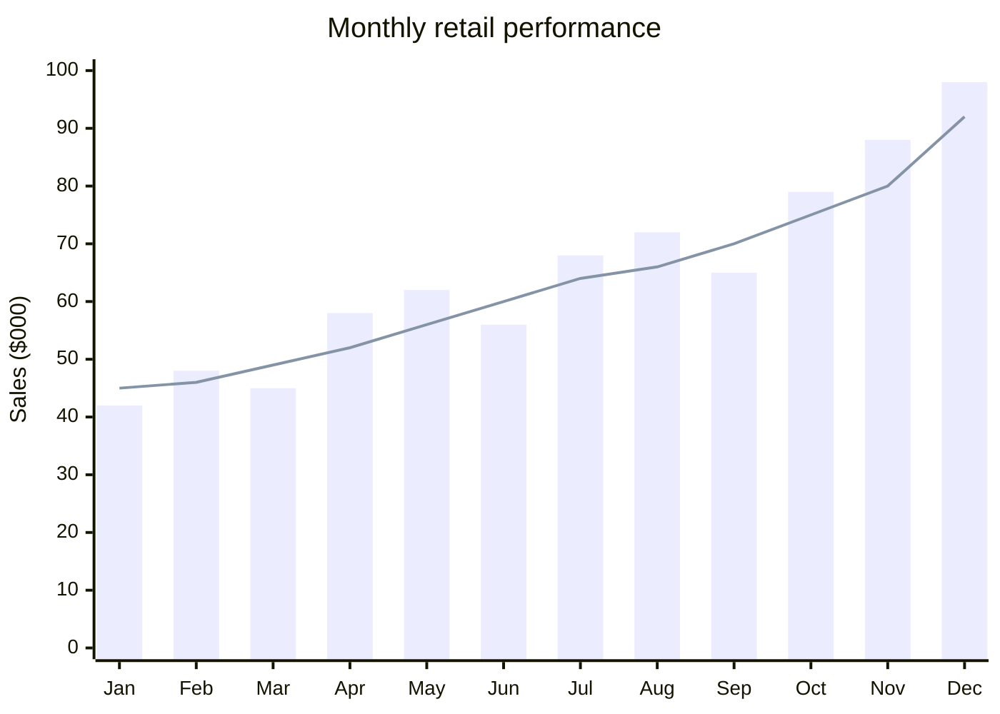

# Day 1 · Audit a monthly performance review

## 1. Meet the parameters

Imagine a Tableau sheet with Month on Columns and two measures sharing Rows. To read the equivalent ECharts option, ask three questions separately. **Which cells supply the coordinates? How do the axes position them? How does each series draw them?**

| Option | Read it in this chart |
| --- | --- |
| `dataset.source` | The DataFrame. Each named column is a dimension available to the series. |
| `xAxis.type: "category"` | Allocate an equally spaced slot to each month label. A string such as Mar has no calendar order of its own. |
| `yAxis.type: "value"` | Position numeric values on a linear scale. A four-unit difference occupies the same vertical distance anywhere on that scale. |
| `series[0].encode` | For each source row, read the field named by `x` and the field named by `y`. Zero selects the first series. Two series can read the same row independently. |
| `series[i].type` and `name` | Draw the coordinates as bars or as a connected line. The name identifies the series to the reader. Studio names it after the measure. |
| `tooltip.trigger` and `tooltip.order` | Inspect one mark with `item` or compare series at one axis position with `axis`. With an axis tooltip, `valueDesc` puts the higher value first at each month. |
| `dataset.transform` and `series[i].datasetIndex` | A sort creates a derived table. The index tells each series which table to read. Reordering month categories changes which observations the line connects. |

## 2. The challenge

Finance says the year finished ahead of target. Operations wants to know which month needs a retrospective. Deliver a monthly chart that supports both claims, lets someone verify a miss on hover, and can withstand a request to rank the months. Budget about 30 minutes, including the independent handover.

## 3. See the whole picture

This is the initial comparison. Bars are Revenue and the line is Target, both in thousands of dollars. As you build, watch for a month where the taller bar and the larger shortfall tell different stories.



Read the central fragment as two instructions per series. Find the coordinates, then draw them.

```python
{
    "dataset": {"source": df},
    "xAxis": {"type": "category"},
    "yAxis": {"type": "value"},
    "series": [
        {"name": "Revenue", "type": "bar", "encode": {"x": "Month", "y": "Revenue"}},
        {"name": "Target", "type": "line", "encode": {"x": "Month", "y": "Target"}},
    ],
}
```

## 4. Know the dataset

Open **Bar chart → Monthly retail** in a fresh session. Start with Month on X, Revenue alone on Y, and no sort or filter. The preview shows the first three of twelve monthly observations. January has 42 revenue against 45 target, February 48 against 46, and March 45 against 49. Values are in $000. A gap in dollars is (Revenue − Target) × 1,000.

## 5. Think it through

Sketch the path from the March row to two marks. Where would you look if March were missing, if its bar ended at 49, or if the line connected March to an unexpected month? Keep your predictions. All three symptoms could appear on a chart with the correct axis types.

## 6. Build, observe, explain

### Investigation A · Reconcile two claims (7 minutes)

**Challenge.** Can the year finish ahead while several months miss? Predict whether the second measure will need a second dataset, axis, or series. Estimate the worst shortfall from the overview.

**Action.** Add Target to the Y fields. Before changing any styling, inspect the two March bars and the option. Select Target under **series → Edit series**, then change its type to line. Inspect the same month again. Find all the misses and calculate the annual net difference using the plotted values or the two sequences above.

**Reflect.** Give Finance one sentence with the annual result, and Operations a different sentence naming the largest miss. Explain why the target line needs twelve Y values even though it uses the same twelve X slots as Revenue. Cite the two Y bindings.

### Investigation B · Design a tooltip that can expose a mistake (7 minutes)

**Challenge.** A reviewer reads the first number on hover as Revenue. Design one tooltip to compare the measures and test whether that shortcut is reliable.

**Action.** Under **tooltip**, try `trigger: item` on the March bar, then `axis` at March. Set `order: valueDesc`. Predict the first named series in February and March before hovering. Try `seriesAsc` at the same two positions. Choose an order for a reviewer who wants to scan Revenue first every month. If hover is unavailable, order the two source rows’ values by hand and inspect the emitted settings.

**Reflect.** Write down what determines membership of the tooltip, what determines order, and which properties still determine bar height. Give a specific case where the shortcut would report the wrong amount.

### Investigation C · Debug a persuasive but misleading line (8 minutes)

**Challenge.** The director wants “best months first” and still wants to call the connected line a *monthly trajectory*. Predict which month will lead a descending Revenue ranking and which month will follow it.

**Action.** In **dataset**, sort Revenue descending. Open **Inspect plotted data**. Compare the first three source and plotted rows, find the derived dataset, and follow both series’ `datasetIndex`. Trace a pair of adjacent points on the Target line that were separated in calendar time. Then build a ranked comparison you could defend. Choose grouped bars or retain the line and give a precise account of what its segments now connect.

**Reflect.** The September shortfall must survive the sort. Verify it. Explain what changed in row order, category order, and adjacency, and which of those changes was visible from `encode` alone.

## 7. Reflect and hand over (4 minutes)

Without replaying the steps, restore the calendar view and the monthly comparison tooltip. Deliver the two reader conclusions and a short handover naming the paths a colleague should inspect if the chart looks ranked again. Show them how to distinguish a Revenue ranking from a ranking by shortfall. The latter would require comparing the two measures or supplying a gap field. The source has Month, Revenue and Target.

<details><summary>Check after the handover</summary>

Annual revenue totals 781 against 755, a $26,000 surplus. January, March, June and September missed. September had the largest miss at 65 against 70, even though its revenue exceeded March’s 45. With value-descending hover, Revenue leads in February (48 vs 46) and Target leads in March (49 vs 45).

Descending Revenue begins Dec, Nov, Oct. Farther along, Jul (68) sits next to Sep (65), skipping Aug on the calendar. Both series read the derived table at index 1. Month remains the X binding and the scale remains categorical. Remove the sort to restore the source sequence. A grouped bar comparison expresses rank without suggesting that adjacent ranks are consecutive months.

</details>

[Apache ECharts dataset and encoding guide](https://echarts.apache.org/handbook/en/concepts/dataset/) · [Tooltip order](https://echarts.apache.org/en/option.html#tooltip.order) · [Sort transform](https://echarts.apache.org/handbook/en/concepts/data-transform/)
