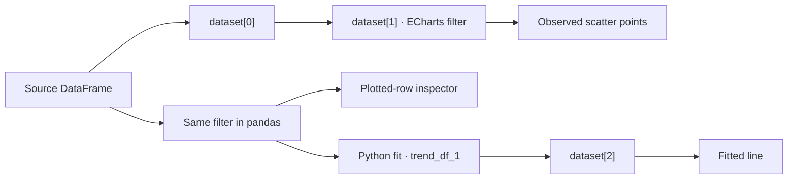

# Studio field guide for course authors

Use this page when translating a proposed lesson into something a learner can do. It describes the builder merged at `626bf89`. The app passes a Python dictionary to Streamlit’s native `st.echarts_chart` with `theme=None`. Streamlit handles the DataFrames in the chart’s datasets. The project records Streamlit 1.67.0 and its bundled ECharts 6.1 renderer as the baseline for its property defaults. [App entry point](https://github.com/kieranadair/streamlit_echart_studio/blob/626bf892b02642785cd2af13c411529ef29e5f45/app.py) · [Project README](../../README.md) · [Native API](https://docs.streamlit.io/develop/api-reference/charts/st.echarts_chart)

## Follow one mark through the system

1. **Source.** The selector shows the first three rows of the DataFrame. Identify the grain, field names, and units. In the regional data, Stores is an amount of sales through stores, measured in thousands of dollars.
2. **Dataset.** The authored option begins with `dataset.source` pointing to `df`. After a filter or sort there is a dataset array. Entry 0 holds the source, entry 1 names its parent through `fromDatasetIndex` and contains the ECharts transform. **Inspect plotted data** shows the full original and the Python mirror of those transformed rows when transforms are active.
3. **Series.** A series chooses its dataset, type, and mappings. For a regional scatter point the coordinates come from Stores and Online. `encode.itemName` can name the point using Region. Two measures can share a DataFrame and have different series types.
4. **Scales and plot.** `xAxis` and `yAxis` define how coordinates become positions. `grid` is the Cartesian plotting region. With several axes or panels, follow the zero-based indices from the series to the appropriate axis and from the axis to its grid.
5. **Reader experience.** A tooltip, brush, annotation, linked pointer, or responsive rule changes how a reader inspects the chart. Ask which action edits the authored option, which is temporary reader interaction, and which would change the rows used to calculate a statistic.

Example for a learner reading a ranked horizontal bar. The author’s question is “Why does Eastern Seaboard appear at the top?” Locate Stores 81 in the plotted table, follow the bar’s `datasetIndex` to the filter or sort, then inspect the category axis’s `inverse` setting. The direction of the bars by itself cannot answer all three questions. [Builder compilation](https://github.com/kieranadair/streamlit_echart_studio/blob/626bf892b02642785cd2af13c411529ef29e5f45/echarts_studio/options.py) · [ECharts dataset handbook](https://echarts.apache.org/handbook/en/concepts/dataset/)

### A filtered trend, end to end

With one filtered scatter series and its fitted line, the app sends two actual DataFrames and one native transform. The browser applies the transform to draw the observed points. Studio mirrors the transform in pandas to show the retained rows and fit the line.

The indices above describe this particular example. Removing the filter moves the fitted dataset to index 1. Following the current series’ `datasetIndex` works in both cases.

## A Tableau translation card

| A Tableau user might look for… | Look here in Studio | Distinction worth testing |
| --- | --- | --- |
| Rows, Columns, discrete and continuous fields | Shared dimension, measure fields, per-series `encode.x` and `encode.y`, `xAxis.type` and `yAxis.type` | A numeric field can have a category scale. Position, spacing, and a meaningful fitted line depend on the scale as well as the field. |
| The aggregation shown on a pill | The grain of `dataset.source`, any `dataset.transform`, and the per-series mapping | Tableau normally aggregates measures at a view’s level of detail. Studio passes the rows provided. A sum per region calls for a table or computation that actually produces that sum. [Tableau aggregation](https://help.tableau.com/current/pro/desktop/en-us/calculations_aggregation.htm) |
| Marks card and Measure Values | `series[i].type`, `encode`, `symbol`, `itemStyle`, `lineStyle`, `areaStyle`, and `stack` | A second series can use the same source and its own mark type. Stacking changes positions of compatible series. The source table keeps its grain. |
| Size, colour, and legends | `visualMap.dimension` with `inRange` or `pieces`, `legend`, root `color` | A series palette distinguishes series. A visual map maps field values to properties such as point size or cell colour. A series legend and a visual scale answer different questions. |
| Reference lines and bands | `series[i].markLine`, `markArea`, and `markPoint` | A fixed threshold has an axis coordinate. A statistical line can specify `type` and `valueDim`. A band needs two endpoints. A text note in `graphic` belongs to the canvas. |
| A trend line or moving table calculation | **Calculated trend** in the series tab, then **Inspect plotted data** | Studio computes the fit or rolling mean on the Python side from the plotted observations. It supplies an additional DataFrame and a line series with its own `datasetIndex`. The displayed option is interpretable alongside the named table. |
| Multiple panes, shared highlighting, or a dashboard text object | `grid` arrays, `axisPointer.link`, `brush`, `graphic.elements`, and `media` | Each panel can have a separate value scale. Pointer linking aligns a common dimension. A note pinned to a canvas corner has a different coordinate system from a data annotation. |

## Read the option with the learner

**View ECharts option** is a readout beneath the explorer. Learners edit through controls. Show a small fragment first and ask them to find it in the complete readout. Paths such as `series[1].encode.y` are navigation shorthand. `df` and `trend_df_1` in the displayed Python refer to actual DataFrames. A JavaScript gallery example may instead supply arrays or use JavaScript functions. Reproduce the *behaviour* using the native API and supported value types. [Streamlit specification and DataFrame support](https://docs.streamlit.io/develop/api-reference/charts/st.echarts_chart)

**Defaults come from different places.** A row can show a renderer default even when its key is absent. A child text style can inherit a chart-level setting. A starting example can deliberately supply a value, such as the shared `stack` name. A calculated domain can come from the source values. Ask “Where did this value come from?” before asking how to change it. Resetting a literal edit, disabling an optional branch, and starting a fresh example are three distinct experiments. [Property catalogue](https://github.com/kieranadair/streamlit_echart_studio/blob/626bf892b02642785cd2af13c411529ef29e5f45/echarts_studio/schema.py)

**Some good UI labels describe multiple option entries.** **Swap X and Y** changes axis roles and encodings. **One grid per series** constructs grids, axes, and indices. The **Chart** tab writes root keys such as `backgroundColor`, `color`, and `textStyle`. **Preview size** sets the Streamlit chart dimensions. ECharts evaluates `media.query` against the resulting chart size. A width selected in Studio can be constrained by its column. Test both sides of a breakpoint at actual rendered widths. [Layout logic](https://github.com/kieranadair/streamlit_echart_studio/blob/626bf892b02642785cd2af13c411529ef29e5f45/echarts_studio/layers.py)

## What can be taught with each starter

| Named starter | Existing mechanism | A useful check |
| --- | --- | --- |
| Bar chart | Shared and per-series bindings, chart type, optional branches | Add Target without copying Revenue’s source values. |
| Stacked bars | Several series share one `stack` value | Release one channel from the stack and reconcile its contribution. |
| Area chart | A line with `areaStyle.opacity` | Restore the fill setting, then examine a missing interval on Weather log. |
| Scatter plot / Bubble plot | Numeric coordinates and optional continuous size mapping | A size edit changes the marker diameter while preserving both coordinates. |
| Heatmap | One DataFrame row per cell and a continuous or piecewise colour map | Transposing the axes preserves a named cell’s value. |
| Rank the regions | Horizontal chart, inverse category axis, and native sort | The plotted table and screen order can be changed independently. |
| Benchmarks and bands | Fixed and statistical lines plus an interval | Filter rows and check the fixed rule alongside the recalculated statistic. |
| Linear fit / Moving average | Derived DataFrames and extra line series | Identify the source of a fitted endpoint or the first complete rolling window. |
| Linked panels | Grid and axis arrays plus linked pointers | Align the same month across two independent scales. |
| Responsive layout | `baseOption` and `media` rules | Check an actual width on each side of 500 px and read the legend and grid overrides. |

## Fine-tuning challenges for experienced chartmakers

Use one of these when the learner already understands the day's core mechanism. Ask which comparison the edit improves, then have the learner name the unit and owning property. The data relationship should still be traceable.

- **Give bars room to breathe.** Open Stacked bars and release Wholesale from the stack. On the last bar series, vary `barGap` and `barCategoryGap` one at a time. Which percentage changes the space between bars in the same region, and which changes the room between region groups? Check the Pacific Northwest total afterwards. [Bar spacing](https://echarts.apache.org/en/option.html#series-bar.barGap)
- **Make the target easy to find.** Build the retail target line, set its `lineStyle.type` to dashed, and adjust its width. Try a different palette and ask a reader to identify Target using the line treatment. This gives the chart an identity that survives a colour change. [Line style](https://echarts.apache.org/en/option.html#series-line.lineStyle)
- **Give the heading a hierarchy.** Enable title, enter a heading and subheading, then vary `title.itemGap`, `title.textStyle.fontWeight`, and `title.subtextStyle.fontSize` separately. Compare that local scope with changing the chart's inherited font family. A sales title can name the question and its subheading can carry the units. [Title](https://echarts.apache.org/en/option.html#title)
- **Protect long region labels.** Open Rank the regions. Enable grid and vary its left inset at a narrow preview width. Inspect the `outerBoundsMode` and `outerBoundsContain` controls and read their reference entries. Check where the labels and plot rectangle end up before trading away plotting area. [Grid outer bounds](https://echarts.apache.org/en/option.html#grid.outerBoundsMode)

## When a lesson appears to fail

| Symptom | Quick diagnostic |
| --- | --- |
| A learner returns to a starter and sees yesterday’s edits. | A starter/dataset pair retains its document within the session. Supply the intended bindings and flags, or start a fresh session. Toolbox Restore resets chart interaction. Author edits live in the explorer. |
| The expected series style has no effect. | Check which measure is selected for editing, its `type`, and the option entry it generated. For a component such as the grid background, check both the branch and `grid.show`. |
| A fit disappears or a rolling line starts late. | Inspect the retained rows, effective axis types, number of distinct X values, missing measures, and window length. A missing estimate can be the correct result. |
| A zoomed chart seems to disagree with **Inspect plotted data**. | The inspector mirrors the authored source transforms. Zoom is ECharts interaction and its `filterMode` can affect internal processing. The inspector is a way to check what the app supplied. |
| “Right margin” changes at the wrong screen width. | The condition applies to the chart’s rendered width. Compare a wide enough column with a forced narrow preview and inspect `baseOption` as well as `media`. |

**Curriculum delivery work still ahead.** Today there are example/dataset selectors, searchable option branches, contextual hints, immediate rendering, and a displayed option. Thirty named lesson starts, persistent course progress, external datasets, and an editable code-import workflow are separate capabilities. The core course can use a recipe, a fresh session, and personal notes. [Delivery decisions](delivery-plan.md)
